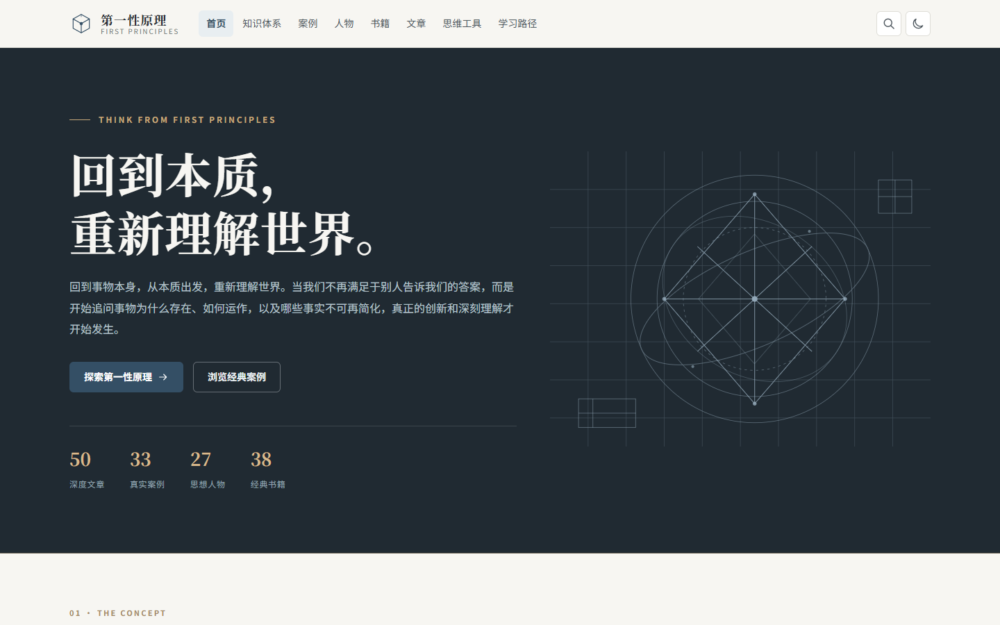
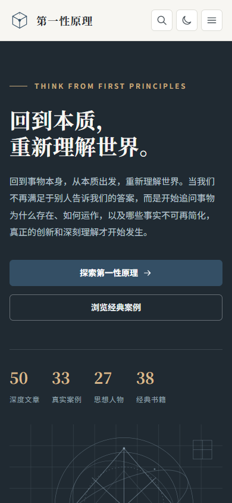
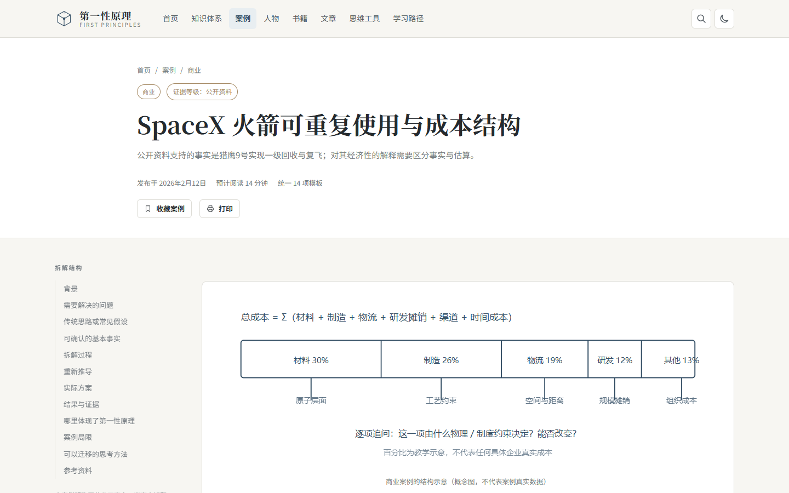
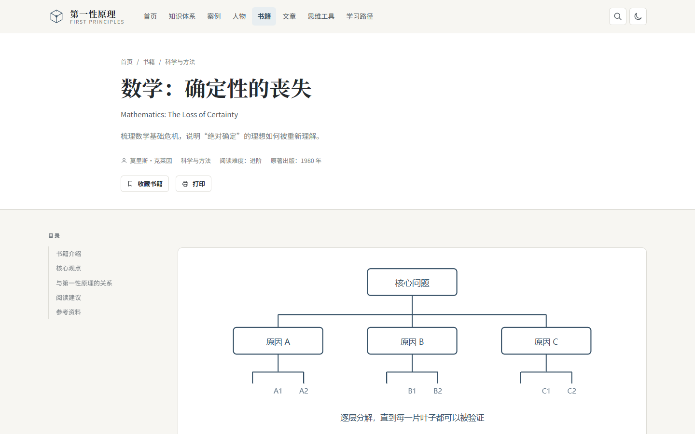
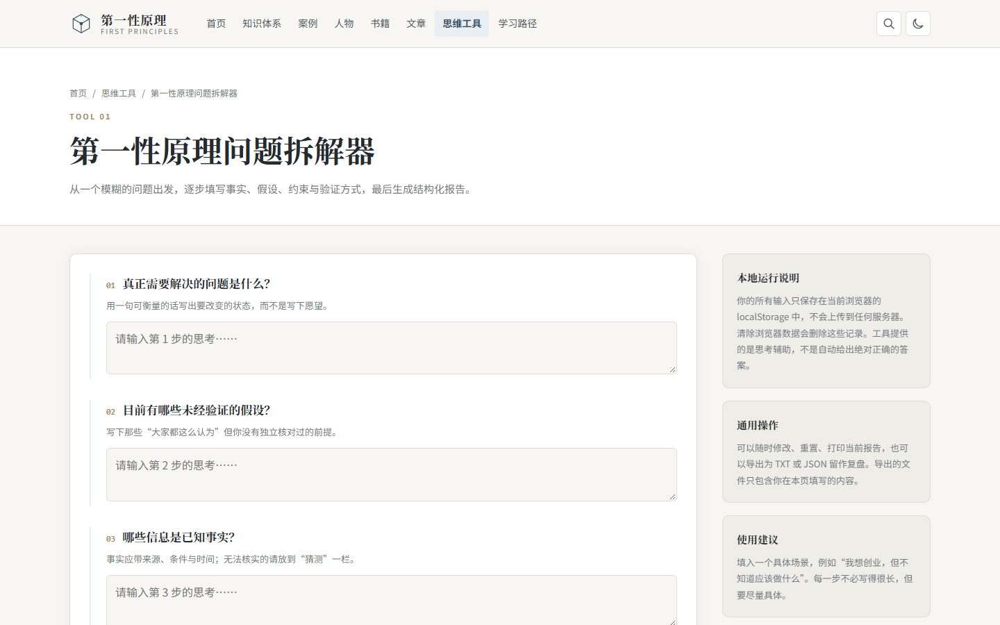

# 第一性原理（First Principles）

> Think Deeper, Understand Better
>
> 回到事物本身，从本质出发，重新理解世界。

一个系统研究和传播第一性原理思维方式的中文知识网站。项目为纯静态站点，可部署到 GitHub Pages，无需后端、数据库或用户账号。

---

## 1. 网站介绍

本站不是概念介绍页，也不是名人语录合集，而是一个可以持续扩充的中文知识库。它通过哲学思想、科学方法、数学逻辑、工程实践、商业创新、历史案例、人物思想与经典书籍，帮助读者理解第一性原理，并学会在现实生活和工作中使用它。

内容坚持三条编辑原则：

- **区分证据等级**：案例明确区分公开资料支持的事实、当事人的公开解释、作者分析与教学示例；商业案例同时说明适用范围、成功条件与局限。
- **不编造来源**：不虚构论文、实验、统计数字、专家观点或企业内部决策过程；书籍只记录可核实的原著年份，无法确认的信息省略或标注待核实。
- **说明适用边界**：文章提供定义、推理、案例、反例与边界，争议理论明确标注争议，不把个人判断伪装成科学定论。

## 2. 网站定位

| 维度 | 说明 |
| --- | --- |
| 主题 | 第一性原理及其在哲学、科学、数学、工程、商业、个人生活中的应用 |
| 读者 | 希望建立独立判断能力的学习者、研究者、工程师、产品与管理人员 |
| 形式 | 知识库 + 深度长文 + 结构化案例库 + 人物与书籍档案 + 本地思维工具 |
| 边界 | 不提供投资、医疗、法律等专业建议；不提供受版权保护的书籍全文 |

## 3. 网站功能

- 完整首页：独立 Hero、九大内容区块、知识地图与最新更新。
- 十个知识专题：从基础、哲学、逻辑、科学到工程、商业、生活、教育、社会和实践工具。
- 结构化案例库：统一 14 项模板，标注证据等级、局限与可迁移方法。
- 人物思想档案：区分“明确讨论第一原理”“相近方法”“现代语境”三类人物。
- 经典书籍库：核实书名、作者、原著出版年份，标注阅读难度与关联内容。
- 深度文章库：目录、阅读进度、字号与行宽调整、深色阅读、收藏、打印。
- 四个互动工具：问题拆解器、假设审查、决策分析器、案例拆解练习。
- 三阶段学习路径：每阶段配有文章、书籍、案例与练习。
- 全站中文搜索：覆盖文章正文、案例、人物、书籍与专题，支持类型与分类筛选。
- 本地数据：收藏、阅读记录、工具输入均保存在浏览器 localStorage。
- 主题：浅色 / 深色 / 跟随系统，支持 `prefers-reduced-motion`。

## 4. 技术栈

| 类别 | 选择 |
| --- | --- |
| 构建 | Vite 6 |
| 框架 | React 18 + TypeScript 5 |
| 路由 | react-router-dom 6（HashRouter，适配 GitHub Pages 子路径） |
| 样式 | 原生 CSS，无 UI 组件库 |
| 内容 | TypeScript 数据文件，结构化区块（h2/h3/p/list/callout/quote/table） |
| 搜索 | 浏览器本地索引，无搜索服务 |
| 持久化 | localStorage |
| 运行时依赖 | `react`、`react-dom`、`react-router-dom` |
| 开发依赖 | `vite`、`@vitejs/plugin-react`、`typescript`、`@types/react`、`@types/react-dom` |

没有动画库、图表库、Markdown 解析器、UI 框架或后端依赖。生产构建产物约 499 KB（gzip 约 162 KB），其中大部分是内容文本。

## 5. 网站页面结构

| 路径 | 页面 |
| --- | --- |
| `/` | 首页（独立 Hero + 九个内容区块） |
| `/about/` | 关于本站 |
| `/foundations/`、`/philosophy/`、`/logic/`、`/science/`、`/engineering/`、`/business/`、`/life/`、`/education/`、`/society/`、`/practice/` | 十个知识专题 |
| `/topics/` | 专题总览 |
| `/cases/`、`/cases/[slug]/` | 案例总览与详情 |
| `/people/`、`/people/[slug]/` | 人物总览与详情 |
| `/books/`、`/books/[slug]/` | 书籍总览与详情 |
| `/articles/`、`/articles/[slug]/` | 文章总览与详情 |
| `/tools/` | 思维工具总览 |
| `/tools/problem-breakdown/` | 第一性原理问题拆解器 |
| `/tools/assumption-check/` | 假设审查清单 |
| `/tools/decision/` | 决策分析器 |
| `/tools/case-practice/` | 案例拆解练习 |
| `/learning-path/` | 学习路径 |
| `/search/` | 全站搜索 |
| `/privacy/` | 隐私说明 |

由于使用 HashRouter，实际 URL 形如 `https://yuxinrun.github.io/first-principles/#/cases/spacex-reusable-rocket`。刷新页面不会出现 404。

## 6. 项目目录说明

```text
public/                     静态资源：favicon、OG 封面、robots、sitemap
src/
  assets/svg/               16 个原创 SVG 文件（含图标 symbol 集合）
  components/               Header/Footer 布局、卡片、目录、工具外壳、图标
  content/
    articles/               50 篇文章，按主题分 6 个数据文件
    cases/                  33 个结构化案例，按领域分 5 个数据文件
    people/                 27 位人物档案，分 3 个数据文件
    books/                  38 本书籍，分 5 个数据文件
    index.ts                内容汇总、索引与关联查询
    learning-path.ts        三阶段学习路径数据
  data/site.ts              品牌信息、导航、专题定义
  pages/                    全部页面（布局实现位于 components/Layout.tsx）
    tools/                  四个互动工具页面
  styles/global.css         全站设计系统与响应式样式
  types/content.ts          内容类型定义
  utils/                    本地存储、SEO、搜索、导出、文本工具
docs/screenshots/           真实浏览器截图
.github/workflows/deploy.yml  GitHub Actions 部署配置
image-sources.md            图片与 SVG 来源记录
```

## 7. 本地运行

环境要求：Node.js 18+（推荐 20 或 22）、npm。

```bash
npm install
npm run dev
```

Vite 的 `base` 配置为 `/first-principles/`，因此本地开发时请访问终端输出的地址（通常是 `http://localhost:5173/first-principles/`），而不是根路径。

## 8. 本地开发命令

```bash
npm run dev        # 启动开发服务器
npm run build      # TypeScript 检查 + 生产构建，输出到 dist/
npm run preview    # 本地预览构建产物
npm run typecheck  # 仅执行 TypeScript 类型检查
```

## 9. 生产构建

```bash
npm run build
```

构建产物位于 `dist/`。CSS 与 JS 均使用相对 `base` 路径，SVG 通过 Vite 的 `?raw` 导入后内联到 JS 中，因此部署到仓库子路径后不需要额外配置。

## 10. GitHub Pages 部署步骤

仓库：`https://github.com/yuxinrun/first-principles`

目标地址：`https://yuxinrun.github.io/first-principles/`

1. 推送代码到 `main` 分支。
2. 打开仓库 **Settings → Pages**。
3. 在 **Build and deployment** 中，将 **Source** 选择为 **GitHub Actions**。
4. 确认仓库 **Settings → Actions → General → Workflow permissions** 中已选择 **Read and write permissions**，并勾选允许创建和批准 pull request 的 token 权限（部署需要 `pages: write` 与 `id-token: write`）。
5. 首次部署可能需要手动触发：进入 **Actions** 标签，选择 **Deploy to GitHub Pages**，点击 **Run workflow**。
6. 等待构建与部署完成后访问目标地址。

`.github/workflows/deploy.yml` 已完成以下配置：

- 监听 `main` 分支 push 与手动触发。
- `permissions` 包含 `contents: read`、`pages: write`、`id-token: write`。
- Node 20 + `npm ci` + `npm run build`。
- 上传 `dist/` 作为 Pages artifact。
- 使用 `actions/deploy-pages@v4` 部署到 `github-pages` 环境。

> 注意：GitHub Pages 不会自动开启，必须在仓库设置中按上述步骤选择 Source。若仓库名或用户名变更，需要同步修改 `vite.config.ts` 的 `base`、`index.html` 中的 canonical/OG 地址、`public/sitemap.xml`、`public/robots.txt` 以及 `src/data/site.ts` 的 `url`。

## 11. 图片与 SVG 资源说明

网站所有插画、图标、Logo、Hero 图形和结构图都是**原创本地 SVG**，使用 `currentColor` 描边以适配深浅主题，通过 `?raw` 内联构建。没有使用远程图片 URL，没有加载远程字体。

逐文件用途、作者与许可记录见 [`image-sources.md`](./image-sources.md)。

## 12. 真实网页截图

以下截图均由 Playwright 实际运行本站后截取，保存在 `docs/screenshots/`：

| 截图 | 相对路径 |
| --- | --- |
| 首页 PC（1440×900） | `docs/screenshots/home-pc.png` |
| 首页手机（390×844） | `docs/screenshots/home-mobile.png` |
| 文章详情页 | `docs/screenshots/article-detail.png` |
| 案例详情页 | `docs/screenshots/case-detail.png` |
| 书籍详情页 | `docs/screenshots/book-detail.png` |
| 思维工具 | `docs/screenshots/tool.png` |












## 13. 内容新增与维护方式

**新增文章**：在 `src/content/articles/` 对应文件中追加一个 `Article` 对象。字段包括 slug、标题、副标题、摘要、分类、标签、日期、阅读时间、`blocks` 正文与 `references`。`blocks` 支持 `h2`、`h3`、`p`、`list`、`callout`、`quote`、`table` 七种类型；`h2`/`h3` 会自动生成目录与锚点。

**新增案例**：按 `CaseStudy` 的 14 项模板填写，并明确 `evidenceLevel`。不要补写无法核查的企业内部决策过程。

**新增人物 / 书籍**：分别按 `Person`、`Book` 类型追加。人物必须填写 `stance`；书籍无法核实的原著年份请留空。

**新增专题**：在 `src/data/site.ts` 的 `topics` 数组中添加，并在 `src/App.tsx` 中增加对应路由。

内容索引、搜索结果与首页统计会自动更新，无需手动修改计数。

## 14. 隐私与本地数据说明

本站没有账号系统、后端与数据库。localStorage 中保存：

- `fp:reading-settings`：主题、字号、行宽
- `fp:favorites`：收藏项
- `fp:reading-records`：阅读进度
- `fp:tool-*`：四个思维工具的输入

搜索在本地索引上执行，关键词不会发送到任何服务器。没有第三方统计、广告或远程字体请求。详见站内 `/privacy` 页面。在共享设备上请使用浏览器清除站点数据。

## 15. 贡献方式

1. Fork 仓库并创建分支。
2. 新增或修改内容时，优先保证事实可核查、边界说明完整。
3. 运行 `npm run build` 确认类型检查与构建通过。
4. 提交 PR，并说明修改的内容类型与依据来源。

请勿提交未经授权的完整书籍文本，也不要添加无法确认许可的外部图片。

## 16. 后续开发计划

- 将现有文章从结构化摘要扩展为每篇 1500—3000 汉字的完整长文。
- 继续扩充案例库的人物与工程细节，并补充更多可核查的公开资料链接。
- 增加收藏夹与阅读历史的集中查看页面。
- 增加专题级交叉索引与内容推荐。
- 为案例工具增加更多可练习题目与对照维度。
- 持续完善无障碍审查与移动端细节。
